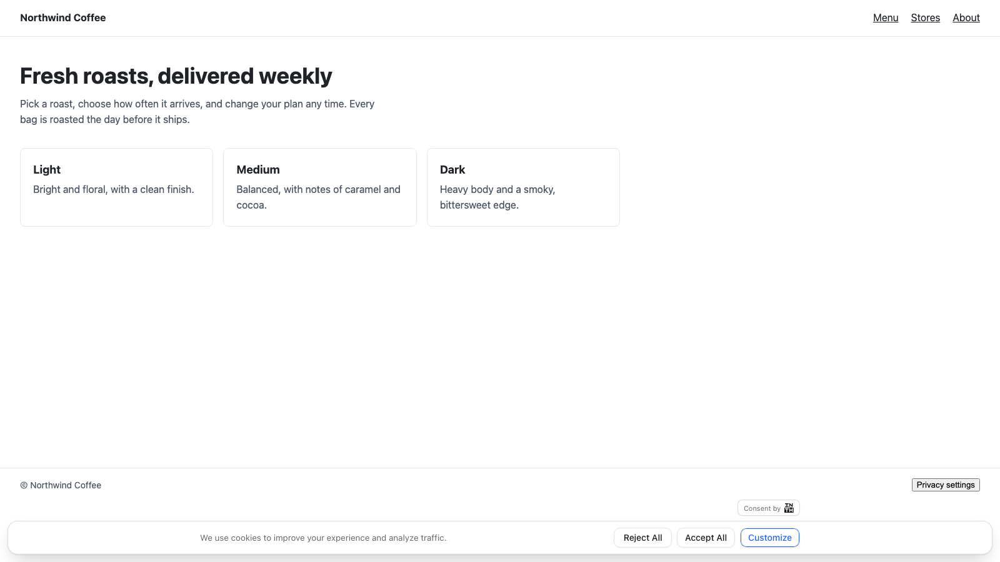
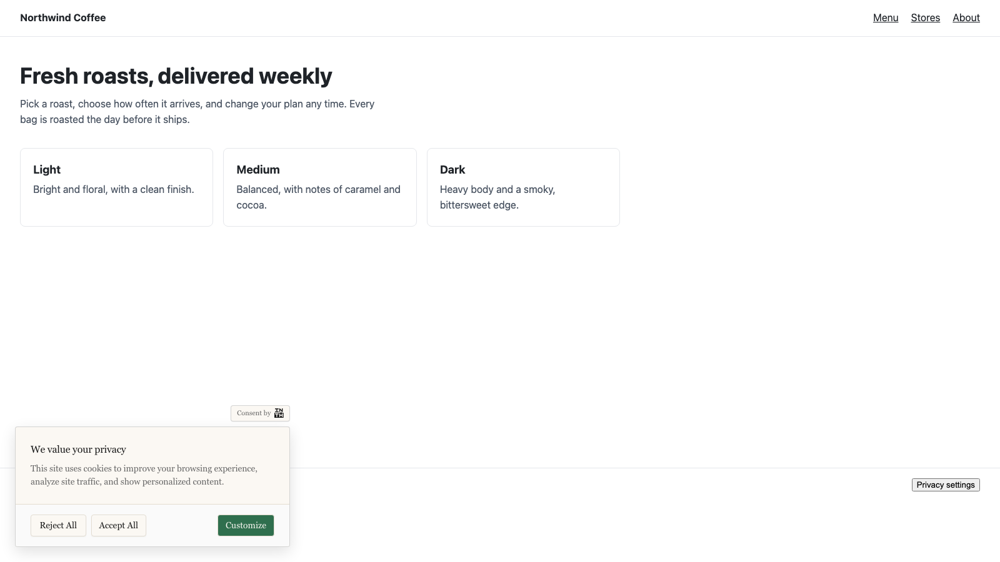
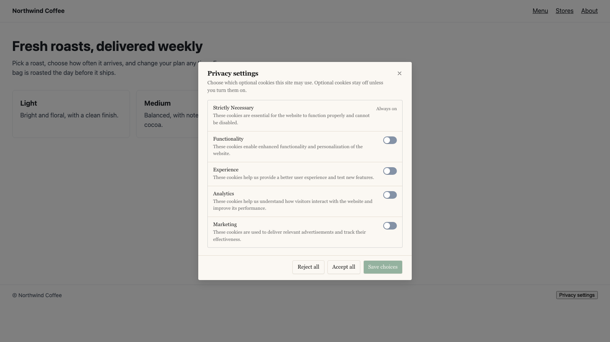
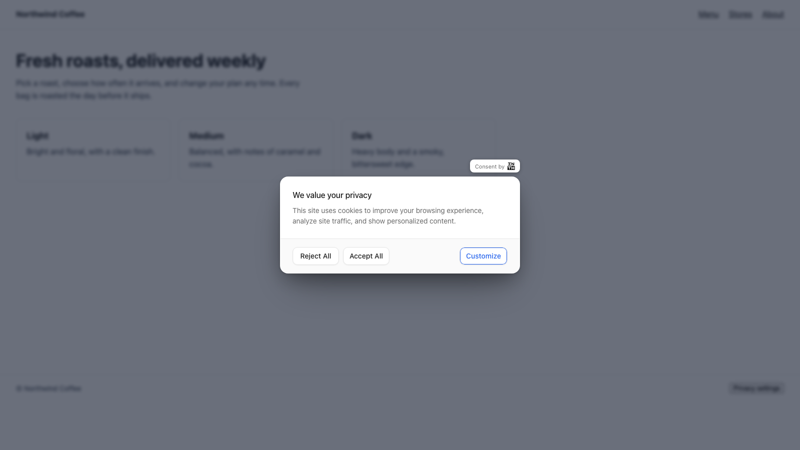
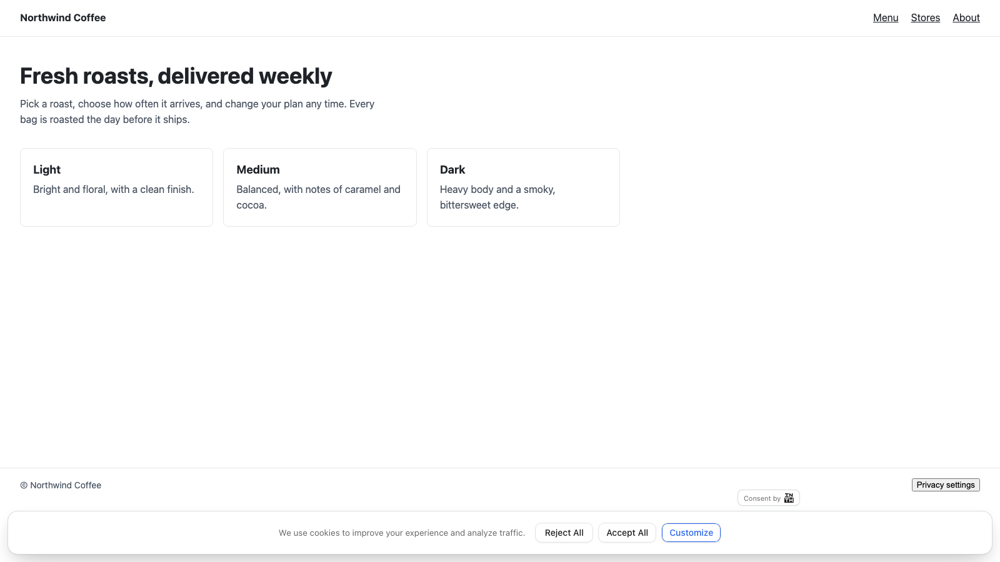
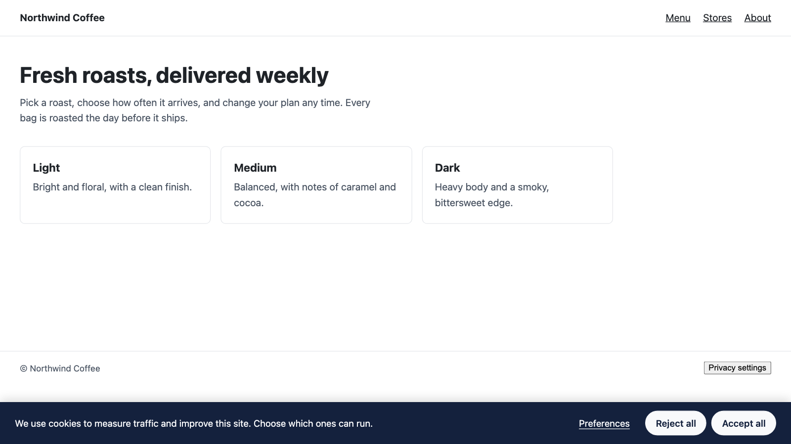
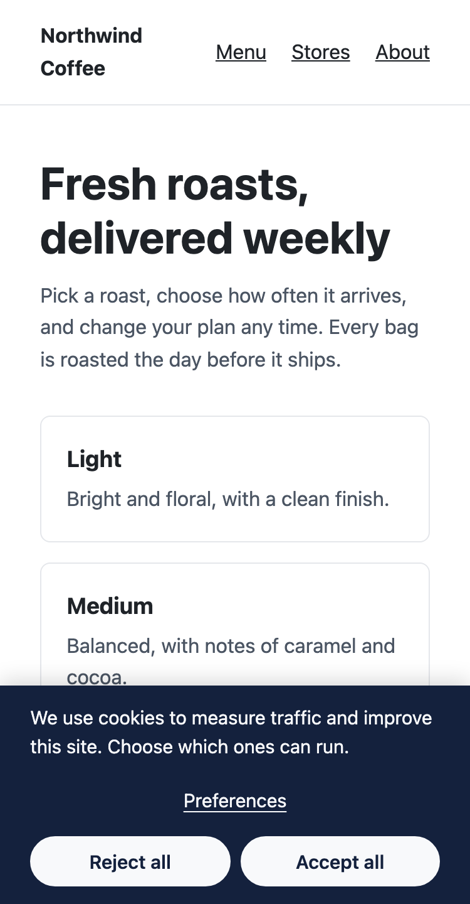
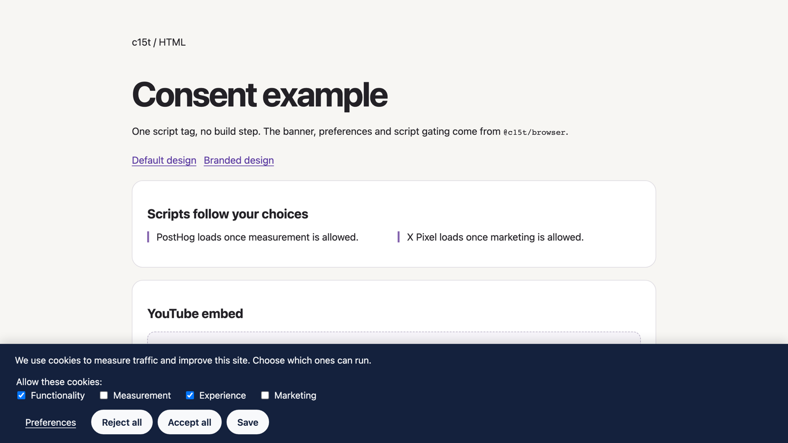

Copy a tested Inth banner built at the level you need, from one prop to headless markup.

## Pick a design

Each screenshot and code snippet comes from Storybook stories that CI runs to verify rendering and consent recording.

| Design | Level | Frameworks |
| --- | --- | --- |
| [Bottom bar](#bottom-bar) | Props | React, Vue, Astro, Svelte |
| [Branded card](#branded-card) | Theme tokens | React |
| [Choice wall](#choice-wall) | Props | React |
| [Slim bar](#slim-bar) | Compound parts or slots | React, Vue, Svelte |
| [Headless bar](#headless-bar) | Headless | React, Vue, Svelte, HTML |

Next.js and TanStack Start use the React code from `@inth/nextjs` or `@inth/tanstack-start`. Nuxt uses the Vue code and SvelteKit uses the Svelte code. See [customize the interface](/docs/customization/overview) to choose a level. Your Inth policy controls which actions appear, and nothing saves consent until a visitor clicks.

## Bottom bar



Set `variant="bar"` and `position="bottom"` to render a full-width bottom bar.

<Tabs items={['React', 'Vue', 'Astro', 'Svelte']}>
  <Tab value="React">
    Mount this local `CookieBanner` wrapper in place of `ConsentBanner` inside `InthProvider`, next to `ConsentDialog`.

    <include src="../shared/examples/storybook-react/bottom-bar.mdx" />
  </Tab>

  <Tab value="Vue">
    Mount `CookieBanner.vue` with `ConsentManager` from `@inth/vue/runtime/components/consent-manager.vue` instead of `InthProvider`, or set `presentation.prompt` in `inth` options.

    <include src="../shared/examples/storybook-vue/bottom-bar.mdx" />
  </Tab>

  <Tab value="Astro">
    Add `presentation` to `inth()` in `astro.config.mjs`.

    <include src="../shared/examples/storybook-astro/bottom-bar.mdx" />
  </Tab>

  <Tab value="Svelte">
    Mount `cookie-banner.svelte` in place of `ConsentBanner` inside `InthProvider`, next to `ConsentDialog`.

    <include src="../shared/examples/storybook-svelte/bottom-bar.mdx" />
  </Tab>
</Tabs>

The HTML script tag uses `presentation.prompt`. See [customize the script tag](/docs/frameworks/html/customize#change-the-banners-shape-and-position).

## Branded card



Theme tokens update colors, fonts, and corner radius without changing markup. This theme sets a green primary color, off-white surface, serif font, and 4px corners, and fills every policy primary action.

<include src="../shared/examples/storybook-react/brand-theme.mdx" />

<include src="../shared/examples/storybook-react/brand-card.mdx" />

Render `ConsentTheme` in a Server Component or root layout so token CSS arrives in initial HTML. Pass `brandTheme` to `InthProvider` as well so `consentActions` apply:

{/* example: fragment */}

```tsx
<InthProvider options={{ mode, theme: brandTheme }}>
```

The preference dialog reads the same tokens:



See [theme tokens](/docs/customization/tokens) and your framework's customize guide for [Vue](/docs/frameworks/vue/customize), [Svelte](/docs/frameworks/svelte/customize), [Astro](/docs/frameworks/astro/customize), or [HTML](/docs/frameworks/html/customize).

## Choice wall



`variant="wall"` centers the banner over a backdrop, locks scroll, and traps focus until the visitor chooses. Use it when your policy requires a choice before access.

<include src="../shared/examples/storybook-react/choice-wall.mdx" />

Choice walls always block. Notices never block, so `variant="wall"` on a notice falls back to a floating card.

## Slim bar



The slim bar places heading, copy, and actions on one row. React composes `ConsentBanner` compound parts, while Vue and Svelte pass slot classes. All three share one stylesheet and preserve required policy actions.

<Tabs items={['React', 'Vue', 'Svelte']}>
  <Tab value="React">
    Mount this `CookieBanner` wrapper inside `InthProvider` next to `ConsentDialog`. `ConsentBanner.PolicyActions` keeps required policy buttons.

    <include src="../shared/examples/storybook-react/slim-bar.mdx" />
  </Tab>

  <Tab value="Vue">
    Spread `slimBar` into `app.use(inth, ...)`. `InthProvider` renders the slim bar.

    <include src="../shared/examples/storybook-vue/slim-bar.mdx" />
  </Tab>

  <Tab value="Svelte">
    Spread `slimBar` into `InthProvider` props and place the CSS rules in a global stylesheet.

    <include src="../shared/examples/storybook-svelte/slim-bar.mdx" />
  </Tab>
</Tabs>

<include src="../shared/examples/storybook-vue/slim-bar-css.mdx" />

## Headless bar



The headless bar pairs your own HTML and CSS with Inth's headless API while the policy still decides which actions render.

<Tabs items={['React', 'Vue', 'Svelte', 'HTML']}>
  <Tab value="React">
    `useHeadlessConsentUI()` from `@inth/react/headless` exposes banner state and `performAction`. Mount `CookieBar` instead of `ConsentBanner` and keep `ConsentDialog`.

    <include src="../shared/examples/storybook-react/headless-bar.mdx" />
  </Tab>

  <Tab value="Vue">
    Composables from `@inth/vue/vue-plugin` provide policy actions and active UI state. Mount `CookieBar.vue` and `ConsentManager` instead of `InthProvider`.

    <include src="../shared/examples/storybook-vue/headless-bar.mdx" />
  </Tab>

  <Tab value="Svelte">
    `getHeadlessConsent()` exposes banner state and `performAction`. Mount `cookie-bar.svelte` instead of `ConsentBanner` inside `InthProvider` and keep `ConsentDialog`.

    <include src="../shared/examples/storybook-svelte/headless-bar.mdx" />
  </Tab>

  <Tab value="HTML">
    `inth.headless.js` keeps script gating and `window.inth` without stock UI or CSS. `data-inth-action` buttons wire up automatically, and Preferences opens inline category checkboxes. Replace `https://your-project.inth.app` with your project URL before `</body>`.

    <include src="../shared/examples/html/headless-bar.mdx" />
  </Tab>
</Tabs>

React, Vue, and Svelte import `cookie-bar.css`. The HTML snippet inlines it.

<include src="../shared/examples/storybook-react/headless-bar-css.mdx" />

At 375px wide, the copy wraps above Preferences and an equal-width action row:



In HTML, Preferences reveals category checkboxes inline:



Headless UIs own focus and labels. Test keyboard and screen-reader navigation, and see headless guides for [React](/docs/frameworks/react/headless), [Vue](/docs/frameworks/vue/headless), and [Svelte](/docs/frameworks/svelte/headless).

## Verify your design

1. Clear site data and reload. Confirm the banner shows and no optional vendor requests fire.
2. Click Reject all, reload, and confirm the banner stays closed and vendors stay blocked.
3. Reopen preferences from your footer link, allow one category, save, and confirm only that category loads.
4. Test a 375px viewport with your longest translation and tab through every button.

See [verify consent](/docs/guides/verify-consent) for the full checklist.
